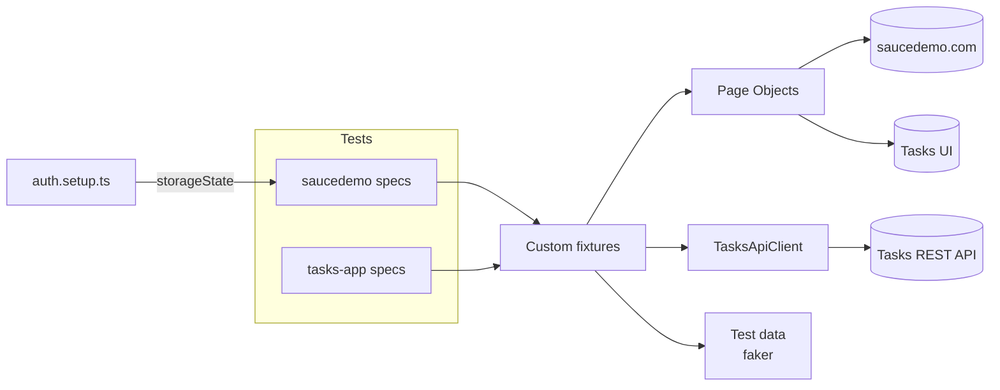

# Playwright E2E Framework (TypeScript)

[](https://github.com/deepakkumar216/playwright-e2e-framework/actions/workflows/playwright.yml)
[](https://deepakkumar216.github.io/playwright-e2e-framework/)

End-to-end test framework built with **Playwright and TypeScript**. It covers two systems:

| Target | What it shows |
|---|---|
| [saucedemo.com](https://www.saucedemo.com) (public e-commerce demo) | Page Object Model, login saved with `storageState`, data-driven tests, checkout maths, visual regression |
| **Tasks app** (small app in [`demo-app/`](demo-app), started automatically by Playwright) | **API-seeded UI tests**: data is created through the REST API, the test acts in the UI, then the result is checked in both the UI and the API |

> 📊 **Live report:** https://deepakkumar216.github.io/playwright-e2e-framework/

## Highlights

- **Page Object Model.** Pages and components in [`src/pages`](src/pages) expose locators and user actions; tests don't contain selectors.
- **Custom fixtures.** [`src/fixtures`](src/fixtures/index.ts) injects page objects, a uniquely registered user per test, a logged-in API client and a logged-in page.
- **Login reuse.** saucedemo logs in once in a setup project and saves the session with `storageState`. The Tasks app logs in through the API and injects the token into `localStorage`, skipping the login form.
- **API-seeded data.** A typed `TasksApiClient` creates and checks data around each UI test. Every test gets its own user, so tests are isolated and safe to run in parallel.
- **Visual regression.** Full-page, page and component screenshots, with dynamic content masked. Baselines are kept per OS, and a workflow regenerates the Linux ones.
- **Debugging on failure.** Traces, screenshots and videos are kept for every failed test.
- **Sharded CI.** 4 parallel shards in the official Playwright Docker image, blob reports merged into one HTML report and published to GitHub Pages. Also runs a type-check and a nightly schedule.
- **Locators.** Uses `getByRole`, `getByLabel` and `getByTestId` (with `testIdAttribute: data-test`), plus web-first assertions.

## Architecture



```
├── demo-app/                 # Tasks app under test (Node, no dependencies): REST API + UI
├── src/
│   ├── api/                  # TasksApiClient: typed API wrapper
│   ├── data/                 # users, products, faker factories
│   ├── fixtures/             # test.extend(): page objects, users, API and auth fixtures
│   ├── pages/
│   │   ├── saucedemo/        # LoginPage, InventoryPage, CartPage, CheckoutPage, HeaderComponent
│   │   └── tasks/            # TasksLoginPage, TasksPage
│   └── config.ts
├── tests/
│   ├── saucedemo/            # auth.setup, login, inventory, checkout, visual
│   ├── tasks-app/            # tasks-ui (API-seeded), tasks-api
│   └── __screenshots__/      # visual baselines
└── playwright.config.ts      # projects, setup dependency, webServer, reporters
```

## Run it

```bash
npm ci
npx playwright install --with-deps chromium

npm test                    # everything (starts the Tasks app automatically)
npm run test:smoke          # @smoke-tagged tests only
npm run test:saucedemo      # one project
npm run test:tasks
npm run test:ui             # Playwright UI mode
npm run report              # open the last HTML report
```

**Visual baselines** are stored per OS. On your first local run, create your own:

```bash
npm run test:visual:update
```

CI compares against the committed `*-linux.png` files. After an intended UI change (or once, after you first push the repo), go to **Actions → Update Visual Baselines → Run workflow**. It regenerates the Linux screenshots in the same Docker image CI uses and commits them.

## Test coverage (47 tests)

| Area | Tests |
|---|---|
| Login | valid login; locked-out user, wrong password, unknown user, empty fields (data-driven); protected-page redirect; logout |
| Inventory | 6 products listed; all 4 sort orders (data-driven); cart badge add/remove; cart survives a reload |
| Checkout | full purchase with **subtotal + 8% tax = total** checked; each required field (data-driven); continue shopping |
| Tasks UI | API-seeded list; empty state; add, complete and delete in the UI with the API checked afterwards; API-side change shows in the UI; validation error; **isolation between users**; login and logout through the form |
| Tasks API | 401 without a token; duplicate username returns 409; full CRUD; 5 invalid payloads; 120-character boundary; type validation |
| Visual | inventory (full page), cart, login, product card, task list (masked) |

## Design decisions

- **Why a local demo app?** saucedemo has no API. Rather than write test data to a third-party server, the repo ships a small app that has a real REST API. Tests stay fast, deterministic and self-contained, and the same pattern applies to any real product.
- **One user per test** instead of shared accounts: no ordering dependencies, safe with `fullyParallel`, and no cleanup step needed.
- **Raw and convenience API methods.** `createTaskRaw()` returns the response so negative tests can assert on status codes. `createTask()` asserts success and returns typed data, for seeding.

## Tech stack

Playwright 1.48 · TypeScript 5 · Node 20 · Faker · GitHub Actions (sharding + merged reports + Pages)
